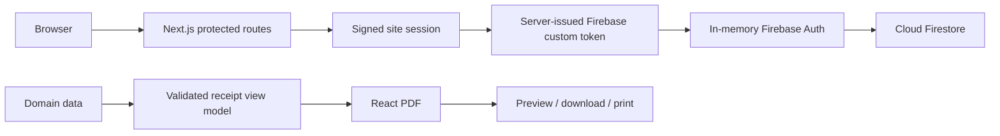

# Quittentia

[](https://github.com/aicha-btn/sci-quittances/actions/workflows/ci.yml)

Quittentia is a responsive web application for landlords and property managers to manage properties and tenants and generate validated, ready-to-print PDF rent receipts.

**Live application:** [https://quittencia.vercel.app](https://quittencia.vercel.app)

Access is restricted.

## Product overview

Quittentia centralizes property, tenant, and landlord information used to prepare rent receipts. It supports individual and company tenants, including multiple tenants attached to the same property.

Application data is stored in Cloud Firestore. A receipt workflow turns validated domain data into a PDF that can be previewed, downloaded, or printed from the application.

## Key features

- Property records with addresses, references, rent, and charges
- Individual and company tenants, with shared rent receipt support
- Landlord settings and month/year receipt selection
- Accent-insensitive search by tenant, property address, or reference
- PDF generation with preview, download, and print actions
- Real-time Firestore subscriptions for application data
- Batched cascade deletion of a property and its associated tenants
- Responsive interface with explicit logout

## Tech stack

- **Frontend:** Next.js 16, React 19, TypeScript, Tailwind CSS, Radix UI, and shadcn components
- **Data and validation:** Cloud Firestore, Firebase, Firebase Admin, Zod, and React Hook Form
- **Documents:** `@react-pdf/renderer` and `react-pdf`
- **Quality:** Node.js test runner, `tsx`, ESLint, TypeScript, and GitHub Actions
- **Deployment:** Vercel

## Architecture



The signed site session is the authority for protected access. Firebase authentication is derived from that validated server session and is kept in memory in the browser.

## Quality and testing

The repository includes 61 deterministic tests covering:

- receipt business logic, formatting, search, and Zod validation;
- site sessions, Firebase token responses, and the Firebase Auth persistence migration;
- persistent login rate limiting;
- PDF view-model preparation and PDF generation;
- batched property and tenant cascade deletion.

The `CI` workflow runs on pushes and pull requests to `main`. It performs a reproducible install, tests, linting, type checking, a production build, and a production dependency audit that blocks critical vulnerabilities.

```text
npm ci
  -> npm test
  -> npm run lint
  -> npm run typecheck
  -> npm run build
  -> npm audit --omit=dev --audit-level=critical
```

## Getting started

### Prerequisite

- Node.js 20.x

### Quality checks

```bash
npm ci
npm test
npm run lint
npm run typecheck
npm run build
```

These checks run without production secrets. Running the complete application requires local Firebase and site authentication configuration.

### Local development

```bash
cp .env.example .env.local
npm run dev
```

Use credentials created for your own local or development environment. Do not copy production secrets into the repository.

## Environment variables

The expected variable names are documented in [`.env.example`](.env.example).

**Firebase client configuration**

- `NEXT_PUBLIC_FIREBASE_API_KEY`
- `NEXT_PUBLIC_FIREBASE_AUTH_DOMAIN`
- `NEXT_PUBLIC_FIREBASE_PROJECT_ID`
- `NEXT_PUBLIC_FIREBASE_STORAGE_BUCKET`
- `NEXT_PUBLIC_FIREBASE_MESSAGING_SENDER_ID`
- `NEXT_PUBLIC_FIREBASE_APP_ID`

**Site authentication**

- `SITE_PASSWORD`
- `SITE_SESSION_SECRET`

**Firebase Admin**

- `FIREBASE_ADMIN_PROJECT_ID`
- `FIREBASE_ADMIN_CLIENT_EMAIL`
- `FIREBASE_ADMIN_PRIVATE_KEY`

`FIREBASE_ADMIN_PRIVATE_KEY` may require multiline-value handling depending on the local or hosting environment. No production values are included in this repository.

## Project structure

```text
app/                 Next.js routes, protected pages, and API handlers
components/          Reusable UI and product workflow components
services/            Firestore data-access services
lib/security/        Session, authentication, and rate-limit logic
pdf/                 Receipt view model, rendering, and PDF tests
validations/         Zod schemas for application forms
firebase/            Firebase client and Admin initialization
firestore.rules      Firestore access rules
.github/workflows/   Continuous integration workflow
```

## Security notes

Security controls include a signed HttpOnly site session with a 12-hour server-side lifetime, Firebase authentication derived from the validated site session, in-memory Firebase Auth persistence, persistent login rate limiting, non-cacheable authentication responses, Zod validation, Firestore access rules, and a CI gate for critical production dependency vulnerabilities.

## Deployment

Production is deployed on Vercel.

Canonical production URL: [https://quittencia.vercel.app](https://quittencia.vercel.app)

## License

License: no explicit open-source license is currently provided.
